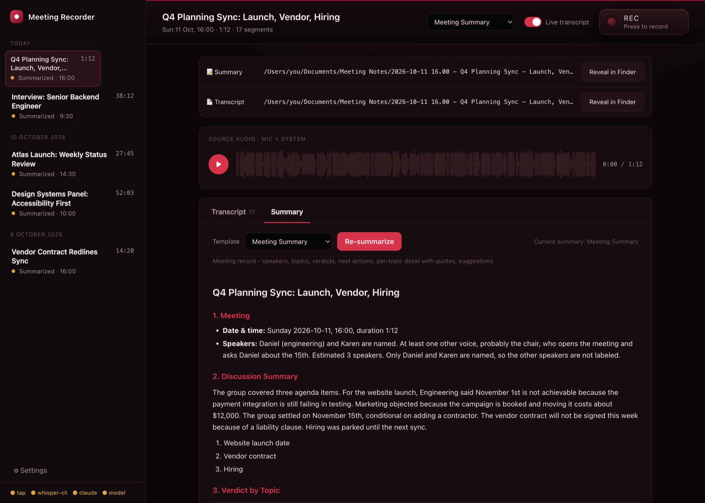
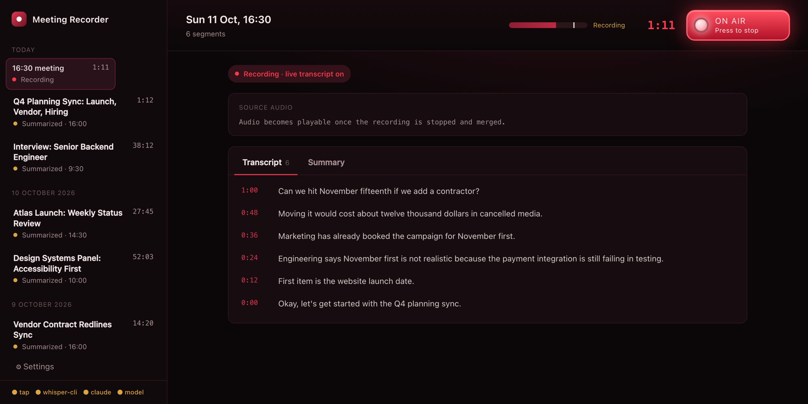
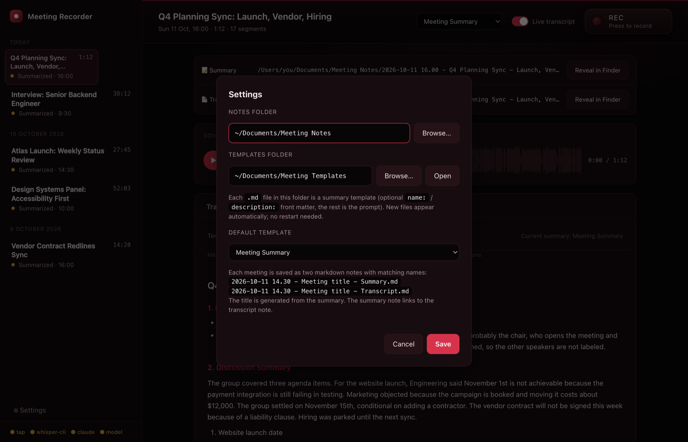

# meeting-transcribe

A local macOS meeting recorder. It captures your **microphone and the other side of the call**
(Zoom, Teams, browser), transcribes on-device with **whisper.cpp**, and writes a structured summary with
the **`claude` CLI**, using templates you can edit.

- **Local audio.** Recording and transcription never leave your Mac. Only the transcript text goes to Claude for the summary.
- **No virtual audio driver.** A Core Audio Process Tap (macOS 14.4+) captures system output, so there is no BlackHole and no output rerouting.
- **Live transcript** while recording (optional), a level meter, then a full re-transcription on Stop.
- **Two matching notes per meeting** in a folder you choose:
  `2026-10-11 15.00 - Q4 Planning Sync - Summary.md` and `… - Transcript.md`.
- **Templates:** Meeting Summary, Interview, Project Status Review, Panel. Add your own by dropping a `.md` into the templates folder. Re-summarize any recording with a different template.

## Screenshots

All data below is synthetic (a scripted `say` voice recording and invented meeting titles); no real recordings or paths are shown.

**A finished meeting**: matching Summary and Transcript notes with Reveal in Finder, source-audio waveform, template picker with Re-summarize, and the six-section Meeting Summary.



**Recording**: the studio-style REC switch is lit "ON AIR", with a live input level meter and a live transcript (newest line first).



**Settings**: choose where the notes and templates live, and the default template.



## Quick start

Requires macOS 14.4+, Xcode Command Line Tools, and the [`claude` CLI](https://claude.com/claude-code).

```bash
git clone https://github.com/dicksonyue/meeting-transcribe && cd meeting-transcribe
./setup.sh     # builds the tap, gets whisper-cli, downloads the ~570 MB model
./verify.sh    # optional: end-to-end self-check
./start.sh     # opens http://127.0.0.1:8765/
```

Run `./start.sh` from your own Terminal, then approve the **Microphone** and **Audio Recording**
prompts the first time you record.

See [`STACK.md`](STACK.md) for architecture, configuration, the API and templates
(or open [`stack.html`](stack.html) for a one-page version).

## Notes

- Whisper has no speaker diarization. The Meeting Summary template estimates the number of speakers and uses names only when the conversation states them.
- Recording meetings may require the consent of the other participants where you live. That is your responsibility.
